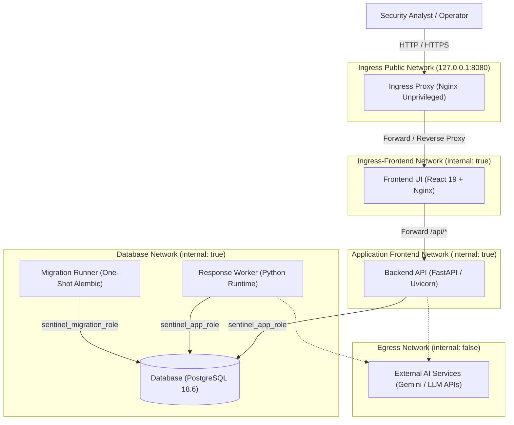

# SentinelAgent

[](https://www.python.org/)
[](https://fastapi.tiangolo.com/)
[](https://www.postgresql.org/)
[](https://www.docker.com/)
[](https://react.dev/)
[](LICENSE)

**Autonomous Security Operations Center (SOC) Investigation and Response Simulation Platform.**

SentinelAgent is a modern, modular cybersecurity platform designed to automate security incident triage, deep forensic telemetry analysis, MITRE ATT&CK technique mapping, historical case recall, and safe, human-authorized simulated response actions.

---

## Research Paper — AVALANCHE 2026

**Title:** *Design and Implementation of SentinelAgent: An AI-Assisted Framework for Cybersecurity Incident Investigation and Human-Approved Response Simulation*

A student research paper presenting the architectural design, threat detection pipeline, AI-assisted investigation agent with provenance tracking, Two-Person Integrity response authorization, and PostgreSQL simulation ledger of SentinelAgent has been prepared for **AVALANCHE 2026** at KLS Gogte Institute of Technology.

* **Full Paper (PDF):** [`docs/research_paper/SentinelAgent_AVALANCHE_2026_Paper.pdf`](docs/research_paper/SentinelAgent_AVALANCHE_2026_Paper.pdf)
* **Research Paper Deliverables & Source:** [`docs/research_paper/`](docs/research_paper/)

---

## 1. Problem Statement

Modern Security Operations Centers (SOCs) face overwhelming alert fatigue, fragmented contextual data, and slow triage cycles. When alerts trigger, analysts must manually correlate telemetry, map observed behaviors to threat frameworks, query historical case databases, and decide on mitigation steps.

Automating these workflows carries serious risk: hallucinations or unverified autonomous actions in a live corporate environment can disrupt legitimate business traffic, break network access, or corrupt operational infrastructure. SentinelAgent bridges this gap by combining automated AI-assisted investigation workflows with **strict human-in-the-loop (Two-Person Integrity) review gates** and **simulation-only response execution**, ensuring zero unvetted changes affect real infrastructure.

---

## 2. Core Features

* **Automated Telemetry Ingestion & Triage:** Ingests authentication logs, SSH audit records, and security events with schema-level validation and deduplication.
* **MITRE ATT&CK Matrix Correlation:** Automatically identifies and maps adversary tactics, techniques, and procedures (TTPs) against enterprise attack patterns.
* **Historical Investigation Recall (Hindsight Memory):** Provides contextual case retrieval to compare current incidents with historically resolved incidents and outbox patterns.
* **Two-Person Integrity (Human Approval Gate):** Enforces a strict separation between the operator proposing a response action and the authorized operator approving it. Self-approval is rejected at the application API layer, while the database enforces lifecycle state machine integrity and immutable audit logging.
* **Simulation-Only Response Orchestration:** Generates and executes response actions strictly within a persistent PostgreSQL simulation ledger (`simulated_blocklist_entries`). **SentinelAgent executes actions via a simulation adapter with zero modifications to live firewalls, host routing tables, or operating system infrastructure.**
* **Mathematical Verification & Reconciliation:** Following simulated action execution, a verification engine runs active probes to evaluate whether the simulation outcome matches intended policy rules.
* **Append-Only Forensic Audit Logging:** All state changes, approval decisions, execution logs, and probe results are recorded in immutable, append-only database tables with zero `DELETE` privileges.
* **Defense-in-Depth Container Architecture:** Multi-network container topology with non-root execution, dropped Linux capabilities, read-only root filesystems, and least-privilege PostgreSQL roles.

---

## 3. System Architecture



### Deployed Services (6 Services)
* **`ingress`:** Dedicated edge reverse proxy (unprivileged Nginx) handling external HTTP/HTTPS traffic.
* **`frontend`:** React 19 Single Page Application (SPA) web server and internal `/api/*` reverse proxy.
* **`api`:** FastAPI ASGI application server hosting REST endpoints, business logic, and health probes.
* **`worker`:** Asynchronous Python response worker processing the outbox queue and running active verification probes.
* **`migration`:** One-shot initialization container executing Alembic migrations to head `34ea070e907d` and locking down database privileges before the API and worker start.
* **`db`:** PostgreSQL 18.6 relational database with role-level privilege isolation and persistent volume storage.

### Network Segmentation (5 Isolated Networks)
1. **`sentinel_ingress_network`:** External bridge network exposing only the ingress proxy to `${BIND_IP:-127.0.0.1}:${FRONTEND_PORT:-8080}`.
2. **`sentinel_ingress_frontend_network` (`internal: true`):** Private network connecting the edge ingress proxy to the frontend container.
3. **`sentinel_frontend_network` (`internal: true`):** Private network connecting the frontend Nginx reverse proxy to the backend API.
4. **`sentinel_db_network` (`internal: true`):** Isolated database tier allowing connections only from `migration`, `api`, and `worker`. Zero host ports are published.
5. **`sentinel_egress_network`:** Docker egress bridge providing outbound internet connectivity for the `api` and `worker` services (e.g., reaching external AI services such as Google Gemini). The `frontend`, `db`, and `migration` services have no egress network attachment.

---

## 4. Investigation Workflow

1. **Event Ingestion:** Security events (e.g., failed SSH logins, brute-force patterns) are ingested via `/api/v1/events/ssh`.
2. **Incident Creation:** Correlated events automatically instantiate an `Incident` record with severity rating and initial indicators of compromise (IOCs).
3. **Automated Tool Runs:** The investigation engine runs diagnostic checks (IP reputation analysis, geo-velocity evaluation, credential attack pattern classification).
4. **ATT&CK Mapping:** Observations are matched against MITRE ATT&CK techniques (e.g., `T1110.001 - Password Guessing`, `T1078 - Valid Accounts`).
5. **Mitigation Proposal:** An analyst or automated rule creates a proposed response action (`ResponseAction`) with an expiration deadline and required justification.

---

## 5. MITRE ATT&CK Integration

SentinelAgent integrates an offline-capable MITRE ATT&CK Enterprise Matrix catalog. Telemetry events and investigation tool findings are evaluated against technique signatures to derive:
* Tactic classifications (`Initial Access`, `Credential Access`, `Lateral Movement`).
* Explicit technique IDs and sub-technique relationships.
* Confidence scoring based on telemetry density.

---

## 6. Hindsight Historical Memory Architecture

The Hindsight integration provides long-term episodic case memory:
* **Transactional Outbox Pattern:** Incidents and investigation resolutions write to `incident_memory_outbox`.
* **Asynchronous Settlement:** A background claim worker processes outbox rows, generates vectorized case representations, and dispatches them to the Hindsight vector service.
* **Historical Case Retrieval:** During active triage, analysts can query similar past incidents to review prior mitigating steps, root causes, and false-positive assessments.

*(Note: In the baseline deployment, Hindsight integration can operate in a mocked/disabled mode or connect to a local companion service).*

---

## 7. Human Approval and Response Simulation Workflow

SentinelAgent implements strict safety guardrails for all response interventions:

```
[Incident Triaged]
        │
        ▼
[Action Proposed]  ──► (Action Payload Hash Generated)
        │
        ▼
[Two-Person Review] ──► Rejects self-approval by proposer (HTTP 403 Application Gate)
        │              ──► Rejects expired proposals
        ▼
[Action Approved]  ──► Action queued to response_outbox
        │
        ▼
[Worker Execution] ──► Executes in SIMULATION ONLY mode (writes to simulated_blocklist_entries)
        │
        ▼
[Reconciliation]   ──► Probes simulate external reachability & verify intended rule state
```

### Safety Contracts:
* **Zero Infrastructure Changes:** Responses are written to simulated sandbox tables (`simulated_blocklist_entries`). No iptables, firewalls, or routing tables are modified.
* **Payload Hashing:** SHA-256 hashes of the proposed payload are calculated at proposal time and verified against approval signatures before execution.
* **Idempotency:** Mutations require client-supplied idempotency keys to prevent duplicate execution or replay attacks.

---

## 8. Verification and Audit Architecture

Following simulated response execution:
1. **Verification Reconciliation Probes:** The worker generates active probes (`verification_reconciliation_probes`) against the target indicator.
2. **Outcome Settlement:** Results are evaluated (`verified`, `failed`, or `inconclusive`).
3. **Forensic Audit Log:** A cryptographic sequence log entry (`response_audit_events`) is written for every state change.

---

## 9. Technology Stack

* **Backend:** Python 3.13, FastAPI, SQLAlchemy 2.0 (async & sync engines), Psycopg 3, Alembic.
* **Frontend:** React 19, TypeScript, Vite, Tailwind CSS, Heroicons.
* **Database:** PostgreSQL 18.6 with multi-role privilege separation.
* **Reverse Proxy & Ingress:** Nginx 1.30 (Alpine, unprivileged).
* **Containerization:** Docker Engine, Docker Compose v2 (multi-stage builds, non-root runtimes).
* **Testing:** Pytest, pytest-asyncio, Node test runner (`node --test`).

---

## 10. Repository Structure

```text
SentinelAgent/
├── .env.example                       # Root environment configuration template
├── alembic.ini                        # Database migration configuration
├── pytest.ini                         # Pytest configuration
├── LICENSE                            # Apache License 2.0
├── README.md                          # Technical architecture and operational guide
├── backend/
│   ├── alembic/                       # Alembic migration management
│   │   ├── env.py                     # Migration runner and model metadata
│   │   └── versions/                  # 6 linear migration revisions (Head: 34ea070e907d)
│   ├── app/
│   │   ├── api/                       # REST API route handlers (events, health, response)
│   │   ├── core/                      # Configuration, settings, security contracts
│   │   ├── db/                        # Database sessions, connection pooling, role alignment
│   │   ├── models/                    # SQLAlchemy ORM models (17 application tables)
│   │   ├── schemas/                   # Pydantic request/response schemas
│   │   ├── services/                  # Business logic, claim worker, verification engine
│   │   ├── workers/                   # Background polling and sweeper runtime
│   │   └── main.py                    # FastAPI application entry point
│   ├── tests/                         # 1,331 automated backend tests across 50 test modules
│   └── requirements.txt               # Backend Python dependencies
├── frontend/
│   ├── src/                           # React UI components, hooks, and context
│   ├── tests/                         # Frontend tests (node --test)
│   ├── package.json                   # Frontend dependencies
│   └── vite.config.ts                 # Vite bundle configuration
├── deploy/
│   ├── sentinelagent/
│   │   ├── compose.yaml               # 5-network, 6-service production Compose specification
│   │   ├── .env.example               # Deployment environment template
│   │   ├── backend/                   # Backend Dockerfile & entrypoint.sh (Python 3.13)
│   │   ├── frontend/                  # Frontend Dockerfile & nginx.conf (React + Nginx)
│   │   ├── ingress/                   # Dedicated edge ingress proxy configuration (nginx.conf)
│   │   ├── init-db/                   # Database role initialization (01-init-roles.sh/.sql)
│   │   ├── scripts/                   # Secret generation and role provisioning scripts
│   │   └── README.md                  # Comprehensive deployment runbook
│   └── hindsight/                     # Companion episodic memory deployment definitions
│       ├── compose.yaml               # Hindsight service Compose specification
│       ├── compose.gpu.yaml           # GPU-accelerated Hindsight specification
│       ├── .env.hindsight.example     # Hindsight environment template
│       └── gateway/                   # Hindsight gateway Nginx proxy configuration
└── docs/                              # Architecture freeze, runbook, and readiness docs
    ├── ARCHITECTURE_FREEZE.md
    ├── DEMONSTRATION_RUNBOOK.md
    └── RELEASE_READINESS.md
```

---

## 11. Local Development Setup

### Prerequisites
* Python 3.13+
* Node.js 22+ & npm
* PostgreSQL 16+ running locally (or via Docker)

### Backend Setup
```bash
# 1. Clone repository
git clone https://github.com/Pranav-Mahesh-Palled/SentinelAgent.git
cd SentinelAgent

# 2. Set up Python virtual environment
python -m venv .venv
source .venv/bin/activate  # On Windows: .venv\Scripts\Activate.ps1

# 3. Install dependencies
pip install -r backend/requirements.txt

# 4. Configure environment
cp .env.example .env
# Edit .env with your local PostgreSQL connection string

# 5. Run database migrations
alembic upgrade head

# 6. Start the API server
uvicorn app.main:app --app-dir backend --reload --port 8000
```

### Frontend Setup
```bash
cd frontend
npm install
npm run dev
# Dashboard available at http://localhost:5173
```

---

## 12. Docker Compose Deployment

SentinelAgent provides a fully declarative, hardened multi-container deployment.

### Quick Start
```bash
cd deploy/sentinelagent

# 1. Generate local deployment secrets (644 permissions inside 700 directory)
./scripts/generate-secrets.sh   # On Windows: ./scripts/generate-secrets.ps1

# 2. Configure environment variables
cp .env.example .env

# 3. Start the entire application stack
docker compose up -d
```

### Service Dependency Ordering
1. **`db` (PostgreSQL 18.6):** Initializes roles and reports healthy.
2. **`migration` (One-shot):** Runs Alembic migrations to head `34ea070e907d`, locks down table privileges, and exits (code 0).
3. **`api` & `worker`:** Start concurrently after migration completes; API reports healthy.
4. **`frontend`:** Starts after API reports healthy; serves SPA and proxies `/api/*`.
5. **`ingress`:** Starts after frontend reports healthy; binds to `${BIND_IP:-127.0.0.1}:${FRONTEND_PORT:-8080}`.

---

## 13. Testing Instructions

### Backend Automated Test Suite
The repository includes **1,331 automated tests** across 50 test modules validating unit logic, MITRE ATT&CK correlation, memory serialization, response state machines, and API contracts.

A dedicated **197-test regression suite** specifically exercises Phase 12 deployment integration, container hardening, database role least-privilege, and configuration boundaries.

```bash
# Run the deployment, security, and configuration regression suite (197 tests)
pytest backend/tests/test_deployment_security.py \
       backend/tests/test_deployment_integration.py \
       backend/tests/test_database_deployment.py \
       backend/tests/test_align_roles.py \
       backend/tests/test_config.py -v

# Run the complete backend test suite (1,331 tests across 50 test modules)
pytest backend/tests -v
```

### Frontend Security & Verification Tests
```bash
cd frontend
npm test
```

### Deployment Configuration Verification
```bash
cd deploy/sentinelagent
docker compose config --quiet
```

---

## 14. Security Architecture and Hardening

* **Schema Architecture & Migration Tracking:**
  * The database schema comprises **17 application tables** across 4 discrete security tiers (8 immutable forensic tables, 2 transactional queue tables, 6 core operational tables, and 1 migration tracking table).
  * The database schema is established through **6 linear Alembic migration revisions** terminating at head revision `34ea070e907d`.
* **Database Least Privilege:**
  * `sentinel_migration_role`: Owns the `public` schema; possesses full DDL and migration privileges used exclusively during one-shot startup migrations.
  * `sentinel_app_role`: Runtime application role used by API and worker. **Zero `DELETE` privileges, zero `TRUNCATE` privileges, zero `REFERENCES` privileges, and zero sequence permissions** across all 17 tables.
* **Network Isolation (5 Discrete Networks):**
  * `sentinel_ingress_network`: External gateway for ingress proxy published port (`${BIND_IP:-127.0.0.1}:${FRONTEND_PORT:-8080}`).
  * `sentinel_ingress_frontend_network` (`internal: true`): Ingress-to-Frontend communication.
  * `sentinel_frontend_network` (`internal: true`): Frontend-to-API communication.
  * `sentinel_db_network` (`internal: true`): Database communication (Database container publishes zero host ports).
  * `sentinel_egress_network`: Outbound Docker bridge network providing internet access for API and worker services (e.g., external AI API calls); frontend, db, and migration services have no egress attachment.
* **Container Security Context (6 Hardened Services):**
  * All containers enforce `security_opt: [no-new-privileges:true]`.
  * `api`, `worker`, `migration`, `frontend`, and `ingress` drop all Linux capabilities (`cap_drop: [ALL]`). *(PostgreSQL retains standard capabilities required for rootless UID 70 user switching).*
  * Read-only root filesystems (`read_only: true`) on all web and application containers with explicit, in-memory `tmpfs` mounts (`noexec,nosuid`).
  * Bounded JSON logging (`max-size: 10m`, `max-file: 3`) to prevent host disk exhaustion.

---

## 15. Current Project Status

* **Phase 12 Deployment Complete:** Full containerization, secret management, migration automation, operational hardening, and live Docker deployment rehearsal completed and verified.
* **Verification Status:** Live deployment rehearsal verified on Docker Engine 29.9.2 with documented host port accommodation.
* **AI & Telemetry Integration Status:** Offline mitigation proposals, rules, and mock LLM providers are fully covered by unit and integration tests. Live Gemini API calls and external Hindsight memory service integration are optional modules and can be activated with valid credentials.

---

## 16. Future Roadmap

1. **Enhanced MITRE Coverage:** Expand automated mapping to cover Cloud and Container attack matrices.
2. **Distributed Outbox Processing:** Enable multi-replica worker clustering with distributed leader election.
3. **Pluggable Response Drivers:** Provide opt-in sandbox plugins for testing responses against simulated AWS VPC security groups and Kubernetes NetworkPolicies.
4. **Mutual TLS (mTLS):** Implement internal mTLS certificates across inter-service Docker networks.

---

## 17. License

Licensed under the Apache License, Version 2.0. See [LICENSE](LICENSE) for details.
